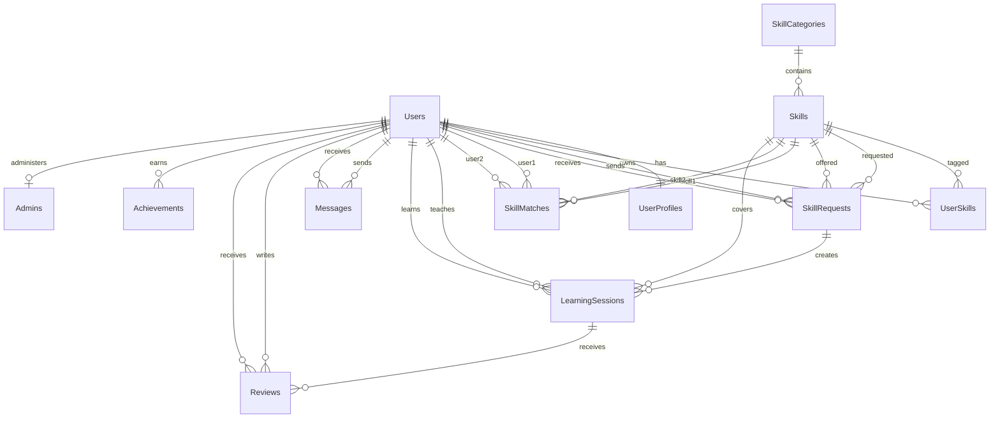

# Swap Your Brain — ER Diagram

The database contains **exactly 12 tables**.

The central many-to-many concepts are represented through `UserSkills`, while exchange compatibility is materialized in `SkillMatches`. `SkillRequests` connects users and skills, and accepted requests can produce `LearningSessions`.
